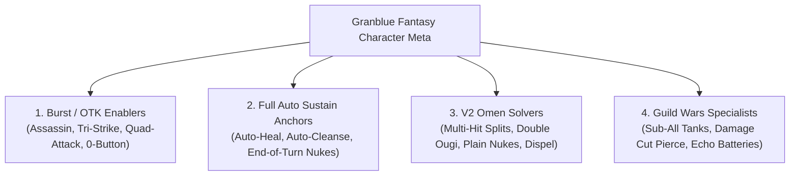
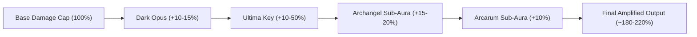

# Volume 19: Character Roles, Synergies & Summon Sub-Auras

**Companion Catalogs:** [`data/combat/character-tiering.catalog.json`](file:///c:/laragon/www/guranburuing/data/combat/character-tiering.catalog.json), [`data/combat/summon-hierarchies.catalog.json`](file:///c:/laragon/www/guranburuing/data/combat/summon-hierarchies.catalog.json)  
**Schemas:** [`data/schemas/character-tiering.schema.json`](file:///c:/laragon/www/guranburuing/data/schemas/character-tiering.schema.json), [`data/schemas/summon-hierarchies.schema.json`](file:///c:/laragon/www/guranburuing/data/schemas/summon-hierarchies.schema.json)  

---

## 1. Tactical Character Roles

Characters in modern Granblue Fantasy are no longer evaluated solely by tier ratings, but by **tactical role specialization**:

### 1.1 Burst / OTK Enablers
- **Mechanics**: Units capable of dealing massive cap-breaking burst without ramp-up.
- **Key Champions**:
  - *Fire*: Percival (Grand) - Grants party 1-turn Tri-Strike (3 full attack phases in a single turn); Zeta (Grand) - Instant assassin nukes.
  - *Water*: Payila (12 Divine General) - Passively attacks 4 times (Quadruple Attack); Gwynne - Turn-1 triple Ougi burst.
  - *Earth*: Sabrina & Hrunting MC - High Tension normal attack doubling; Olivia (Summer) - Permanent Double Strike.
  - *Wind*: Narmaya (Grand) - 1-turn Any-Turn Assassin with 100% TA and multi-echoes.
  - *Light*: Nehan - Teamwide Double Strike + 30% Echoes; Florence (Halloween) - Targeted 1-turn Assassin.
  - *Dark*: Bowman - 0-button passive dual attacks + auto-nuke; Ilsa (Yukata) - Quadruple attacks with Gun allies.

### 1.2 Full Auto Sustain Anchors
- **Mechanics**: Passive abilities that trigger automatically at the end of the turn or reactively upon enemy special attacks.
- **Key Champions**:
  - *Fire*: Satyr - Automatically casts heal, cleanse, and 2-buff dispel upon enemy special attack.
  - *Water*: Haaselia (FLB) - Doubles all skill activations and continuously ramps team water defense and water ATK.
  - *Wind*: Charlotta (Grand) - Unconditional 100% party TA, 1-turn cooldown cuts, and invulnerability.
  - *Light*: Horus - Automatic teamwide debuff cleanse and charge bar generation on charge attack.
  - *Dark*: Fediel & Lich - Fediel provides 10,000 shield and 100% DEF; Lich converts all party debuffs into continuous healing.

### 1.3 High Difficulty / V2 Omen Solvers
- **Mechanics**: Units tailored to satisfy complex Battle System 2.0 cancel conditions (e.g. 36+ hits, 6 Charge Attacks, 5 Debuffs, Dispel 3 buffs).
- **Key Champions**:
  - *Poseidon (Water)*: Passively splits every normal attack into 3 hits (satisfying 36-hit omens effortlessly).
  - *Vajra (Water)* & *Horus (Light)*: Perform double charge attacks at 200% bar to easily clear CA count triggers.
  - *Yuni (Light)*: Instantly resets all party skill cooldowns and refills 100% charge bar on Turn 10+.

---

## 2. Providence Summon Hierarchy & Mechanics

Providence summons represent the highest tier of summon assets in the game:

| Summon | Tier | Primary Function | Core Mechanics & Tactical Value |
| :--- | :--- | :--- | :--- |
| **Beelzebub** | `SSS_Universal` | Burst Engine & Dispel Nuke | **Main Aura**: MC starts at Trance 3 (100% TA, 50% ATK, 20% Cap). **Call**: Deals 2000% elemental damage (~2.5M), dispels 3 buffs, inflicts 40% DEF Down, 3M Plain DMG, and **Bore** (50% debuff res down, 100k supplemental damage). |
| **Belial** | `SSS_Universal` | Passive Supplemental Damage | **Sub-Aura**: Grants +30,000 supplemental damage to all allies for every damage instance. **Drawback**: -30% max HP, but calculated *before* weapon skills, making the actual HP drop negligible in refined grids. |
| **Lucifer (Lv 250)** | `SSS_Universal` | Ultimate Sustain & Dispel Cancel | **Main Aura**: 150% Elemental ATK + 50% Max HP. Auto-cleanses 1 debuff and grants Wings of Pure White on enemy special attacks. **Call**: Heals 4000 HP, grants 30% normal ATK, 1500/10% Revitalize, and **Dispel Cancel (No Limit, 2T)**. |
| **Triple Zero** | `SSS_Universal` | V2 Omen Instant Canceler | **Call Phase 1**: Massive nuke, grants 100% TA and echoes. **Call Phase 2**: Immense plain damage nuke; **instantly cancels 12-hit, 24-hit, or plain damage omens** in high-difficulty raids. |
| **Bahamut (Lv 250)** | `SS_Essential` | Ougi Damage & Gauge Engine | **Main Aura**: 150% ATK, 50% CA DMG, 20% CA Cap. **Sub-Aura**: +30% CA specs. **Call**: 80% CA DMG, 20% CA Cap, refills 30-50% charge bar to all allies. |
| **Yatima** | `SS_Essential` | Skill Cooldown Acceleration | **Call**: 1-turn cut to all allies' skill cooldowns. **Sub-Slot Double Call**: Simultaneously invokes two other equipped sub-summons. |

---

## 3. Sub-Aura Optimization & Stacking Math

Sub-aura summons provide passive enhancements from the sub-summon slots without ever needing to be called:

1. **Archangel Summons (Damage Cap Multiplier)**:
   - *Michael (Fire)*, *Gabriel (Water)*, *Uriel (Earth)*, *Raphael (Wind)*, *Metatron (Light)*, *Sariel (Dark)*.
   - Grants **+10% to +20% Seraphic Damage Cap**. Multiplies directly with weapon grid damage caps.
2. **Arcarum Summons (Elemental Amplification)**:
   - *The Sun, The Moon, The Hanged Man, Judgement, The Star, Death*.
   - Grants **+10% Seraphic Damage Cap** against superior elemental targets. Stacks additively with Archangels for **+30% total Seraphic Cap**.
3. **Six Dragons Summons (Stat Amplification)**:
   - *Wilnas, Wamdus, Galleon, Ewiyar, Lu Woh, Fediel*.
   - Grants **+20% to +40% boost to ATK, DEF, and HP** for all matching element allies.

---

## 4. Operational Runbook for Automation Engine

- **Summon Selector Protocol (`SupporterSelectionService`)**:
  - For Burst workflows (`gw-meat`, `otkraid`, `event-raid`): Match against `Beelzebub` or `Triple Zero` for Quick Summon instakill.
  - For High-Difficulty / Multi-turn workflows (`daily:host`, `pbhl`, `revans`): Match against `Lucifer (Lv 250)` or `Bahamut (Lv 250)` for automated HP and sustain.
- **Sub-Slot Validation Gate**:
  - The automation engine audits sub-summon setups before running High-Difficulty content. If `Belial` is equipped in raids with lethal plain damage entrance triggers (SUBHL), a configuration warning is emitted.
