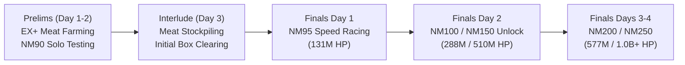

# Volume 21: Unite and Fight (Guild Wars) Optimization & Tactics

**Companion Catalog:** [`data/events/unf-guild-wars.catalog.json`](file:///c:/laragon/www/guranburuing/data/events/unf-guild-wars.catalog.json)  
**Schema:** [`data/schemas/unf-guild-wars.schema.json`](file:///c:/laragon/www/guranburuing/data/schemas/unf-guild-wars.schema.json)  

---

## 1. Event Structure & Progression

Unite and Fight (Guild Wars / UnF) is the primary competitive crew event in Granblue Fantasy, held every 6–8 weeks with a dedicated elemental focus.

---

## 2. Meat Farming Optimization (EX+ 24M HP)

The efficiency of a player's Guild Wars campaign depends directly on **seconds per kill** during preliminary meat farming. Every second shaved off saves hours over 5,000+ meat runs.

### 2.1 The Three Primary Archetypes

| Archetype | Buttons | CAs | Lockout | Speed | Primary Setup & Grid Requirements |
| :--- | :--- | :--- | :--- | :--- | :--- |
| **0B0C (Normal Attack)** | 0 | 0 | ~1.5s | **~2.8s Total** | **Setup**: Press Attack immediately. **Core**: Guaranteed Triple Attack roster (Bowman, Seox, Ilsa, Payila), Falsehood Dark Opus (35% Echo + Double Strike), or Illustrious weapons (Ereshkigal / Hrunting). Belial summon equipped. |
| **0B1C (Single Ougi)** | 0 | 1 | ~2.5s | **~3.8s Total** | **Setup**: First frontline character executes a single massive Ougi (e.g., Chrysaor, Relic Buster, Gwynne). **Core**: High Ougi supplemental weapons (Fediel Spine, Galleon Jaw). |
| **1B (Quick Summon OTK)** | 1 | 0 | ~2.0s | **~3.5s Total** | **Setup**: Tap Quick Summon (`Beelzebub` or `Triple Zero`) -> Press Attack. **Core**: Beelzebub call deals 3M plain damage, inflicts 40% DEF Down and Bore (100k supp); auto-attacks easily finish the remaining 21M HP. |

### 2.2 Turn Lockout Physics & Reload Bypass
Under the server lockout formula:
$$L_{turn} = \max(0, T_{\text{animation}} - \Delta t)$$
Normal attack turns with zero charge attacks yield a minimal server lockout of **1.5 seconds**, compared to **6.5+ seconds** for a 4-chain full burst. Therefore, 0B0C normal attack setups are strictly superior for honor velocity.

---

## 3. Nightmare Difficulty Progression & Counter Strategies

### 3.1 Nightmare 95 (131.25M HP, Def: 16)
- **Objective**: Sub-15 second clears.
- **Key Boss Trigger**: 50% HP threshold strips party buffs and grants the boss a 50% Damage Cut barrier.
- **Tactical Rule**: Frontline units must feature automatic or queued dispel abilities to strip the 50% barrier immediately without wasting a combat turn.

### 3.2 Nightmare 150 (510M HP, Def: 25)
- **Objective**: Sub-90 second Full Auto clears.
- **Key Boss Triggers**:
  - 85%: Deals heavy damage and inflicts Skill Seal / ATK Down.
  - 50%: Wipes all buffs, clears debuffs, and grants 100% TA to the boss.
  - 35%: Multi-hit plain damage check.
- **Tactical Rule**: Shift away from glass-cannon burst grids toward balanced Stamina grids featuring at least 1 Revans Defense weapon and auto-cleanse anchors (Satyr, Haaselia, Horus).

### 3.3 Nightmare 200 (577.5M HP, Def: 30)
- **Objective**: Sub-3 minute Full Auto clears.
- **Threat Level**: Boss attacks hit all 4 party members simultaneously; inflicts deadly status effects: *Zombified*, *Paralyze*, and *Strong Poison*.
- **Critical Safety Interlocks**:
  - **Zombified Safety Interlock**: Automation engines must lock all green potion and recovery abilities while Zombified is active to avoid instant suicide.
  - **50% Unchallenged Dispel**: The boss gains Unchallenged on 50%; at least two dispels must be queued or triggered at end-of-turn.

### 3.4 Nightmare 250 (1.0B+ HP, Def: 35)
- **Objective**: High-difficulty endurance match designed for crew duos or apex solo Full Auto.
- **Core Strategy**:
  - Mandatory **Lucifer Lv 250** (Main or Supporter summon) for +50% max HP, automated special attack cleansing, and continuous Wings of Pure White healing.
  - Full grid defense stacking: 3x Defense Revans weapons (Sette di Spade / Schrodinger / Extinction Blade) providing 65k–85k total HP pool.
  - Invulnerability rotations (Haaselia, Poseidon, Yuni, Anne).
