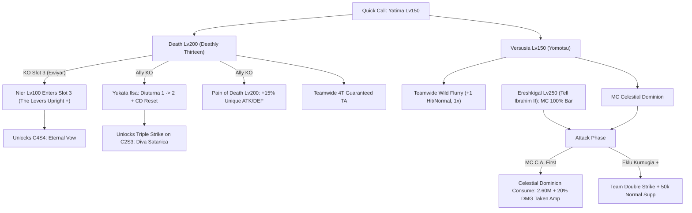

# Volume 23: Guild Wars NM95 Dark Optimization (`Yatima` + `Death` + `Versusia` -> `Nier` / `Ereshkigal`)

**Document Version:** `1.0.0`  
**Subsystem:** Unite and Fight (Guild Wars) Burst Engineering & KMS Telemetry  
**Authoritative Schema:** `data/schemas/gw-nm95-dark.schema.json`  
**Authoritative Catalog:** `data/combat/gw-nm95-dark.catalog.json`

---

## 1. Executive Summary & Boss Mathematics

**Nightmare Lv95 (`teamraid085`)** fights **Lvl 95 Demeter** (`Quest ID: 980681`, `URL: #quest/supporter/980681/1/0/10116`, Cost: `40 AP + 10 Meat`), a Light-element boss with **`131,250,000` HP** and **`15` Base DEF**.

| Metric | Value | Notes |
| :--- | :--- | :--- |
| **Boss HP** | `131,250,000` | Must be defeated in **Turn 1** to skip all `75% / 50% / 25%` triggers |
| **Honors (Full Rotation)** | **`910,385` pt** | `900,000` HP + `10,000` Clear/MVP + `375` Debuff (`C4S2`) + `10` Summon |
| **Legacy Run Time (Deck 133)** | **`36–44s`** (`mean ~38s`) | `~86,000,000` Honors/hr (`~95` runs/hr) |
| **Optimized Target Time** | **`18–23s`** (5-Skill) / **`22–26s`** (6-Skill) | **`142M–182M` Honors/hr** (`~1.7x–2.1x` speed gain) |

---

## 2. The `Yatima` Quick Call -> `Death` + `Versusia` -> `Nier` Engine

Deck `133` rigs `Yatima Lv150` (`quick_user_summon_id: 1301888572`) to be **100% deterministic**:

```text
Main: Yatima Lv150 (Quick Call)
Sub 2: Summer Belial Lv40  [Excluded from Yatima: one-use call]
Sub 3: Death Lv200          [CALLABLE #1]
Sub 4: Versusia Lv150       [CALLABLE #2]
Sub 5: Belial Lv150         [Excluded from Yatima: one-use call]
```

Because both Belials are excluded from `Yatima`'s random pool, clicking **Quick Call** always invokes **`Death Lv200` + `Versusia Lv150`** in 1 action.



> [!IMPORTANT]
> **Why `Bahamut Lv250` and `Beelzebub Lv150` Sub-Auras Deal `0` Damage Here:**
> 1. `Yatima` verbatim: *"Activated calls don't deal call DMG."* Therefore `Bahamut Lv250` (`+50%` summon call DMG / `-1T` CD) contributes **0%** damage on Turn 1.
> 2. `Beelzebub Lv150` sub-aura only grants MC `50%` Perpetuity ATK + `20%` DMG Cap at **Trance Lvl 3**. In a 1-turn `Ereshkigal` burst (`-300%` bar gain), MC C.A.s once (or twice with `Last Love`), capping at Trance Lvl 2 (**0% damage gain**).

---

## 3. Summon Sub-Aura & Friend Audit (`acc1` Verified Box)

| Slot | Current (Legacy) | Optimal Owned Replacement | Exact Turn-1 Impact | Player-Phase Delta |
| :--- | :--- | :--- | :--- |---:|
| **Main (QC)** | `Yatima Lv150` (`1301888572`) | **Keep `Yatima Lv150`** | Calls `Death` + `Versusia` in 1 action | Engine Core |
| **Friend** | `Hades Lv250` | **Keep `Hades Lv250`** | `+170%` Optimus aura + `30%` Dark ATK | Core Aura |
| **Sub 2–5** | `S.Belial Lv40`, `Death Lv200`, `Versusia Lv150`, `Belial Lv150` | **Keep Unchanged** | 100% rigged Yatima pool + `+30k` Supp + `1x` counter net | Engine Core |
| **Sub-Aura 1** | `Beelzebub Lv150` (`0` effect T1) | **`Sariel Lv150` (`977961317`)** | **`+15%` Dark Allies' DMG Cap** | **`+10.0M`** |
| **Sub-Aura 2** | `Bahamut Lv250` (`0` effect T1) | **`Fediel Lv40` (`1510948871`)** | **`+10%` Optimus Aura** (Owned `Hades Lv200` has no sub-aura) | **`+1.2M`** |

---

## 4. Weapon Grid & Cap-Bracket Stacking Laws (Deck `133` Live Audit)

Live `/party/deck/133` `effect_value_info` and verbatim `/weapon/weapon/{id}` tooltips prove exact cap saturation:

| Bracket | Weapon Grid Limit | Current Deck `133` Status | Actionable Implication |
| :--- | :--- | :--- | :--- |
| **Normal Attack Cap (`04_icon_na_dmg_cap`)** | `20%` | **`20%` (`is_max: true`)** from `Ereshkigal` `Disease Demon II` alone | Dark Opus `Katana of Repudiation Lv220` Skill 2 **`α Revelation Ruber` (`+10%` Normal Cap) is 100% wasted**. Swap `α` $\rightarrow$ **`β` (`+50%` Skill Cap)** (`+4.5M–5.5M` on `Eternal Vow` + `Celestial Dominion`). `Claws of Terror` is also redundant. |
| **Normal Attack Amp (`04_icon_normal_dmg_amp`)** | `30%` | **`30%` (`is_max: true`)** from `Ereshkigal` `Gugalanna` | World Harps (`Worldvexing Angelos`, `Worldforging Moros`) do not exceed `30%` and are skipped. |
| **Passive A-Side Echo** | Highest source only | `20%` from Opus `Deceitful Fallacy` (`Falsehood`) | Overrides `Causality Driver`'s `4.5%` `Oblivion's Deathstrike` (confirmed in live packet: Ilsa hits `4` instances/auto instead of `5`). Keep `Causality Driver` strictly for `+30%` Optimus Exalto. |
| **General DMG Cap (`04_icon_dmg_cap`)** | `20%` | **`20%` (`is_max: true`)** (`2x PnS 14%` + `Pain of Death 5%` + `Parazonium Atk4 5%`) | Further cap must come from **summon sub-auras (`Sariel +15%`)** and **character buffs (`Ilsa S1 +15%`)**. |
| **Resonator 4-Group Gate** | `>= 4` same weapon type | **4 Axes:** `Ereshkigal`, `2x Pain and Suffering`, `Scythe of Darkherald` | **Do NOT remove `Scythe of Darkherald` without replacing it with another Axe**, or `Eternal Signature`'s `+7%` Special Cap shuts off! |
| **Fallen Sword Awakening** | Lv 4 Max | Currently `Multiattack Lv1` (`0%` active bonus) | Re-awaken to **`Attack Lv4` (`+35%` ATK)** for `+2.0M` damage consistency on C2/C4 normals. |

---

## 5. Live Packet Damage & Latency Audit (`normal_attack_result.json`)

Captured passively from `acc1` Deck `133` running legacy `templates/gw-nm95-dark.json` (`131,250,000` HP Demeter):

### 5.1 Pre-Attack Skill Latency & Damage ROI
| Order | Action | Measured Latency | Damage Contribution | Efficiency (`M/sec`) | Verdict |
| :---: | :--- |---:|---:|---:| :--- |
| 1 | `C4S2` `Release the Clawvalry! +` (`Ewiyar`) | `3.76s` | `2,217,741` + `~5.85M` (`+30k` supp) | `2.15 M/s` | Optional safe filler (`+375` honor) |
| 2 | `Quick Call` (`Yatima`) + `Reload F5` | `6.31s` | `~30M+` (`Death` + `Versusia`) | `4.75 M/s` | **Core Engine (Mandatory)** |
| 3 | `C4S1` `World of Death and Love +` (`Nier`) | `2.59s` | `~24.0M` (`30%` Echo + `20%` ATK field) | **`9.27 M/s`** | **Keep (Core)** |
| 4 | `C4S3 -> C1` `Last Love` (`Nier -> MC`) | **`4.74s`** | `8,484,247` (`MC C.A. #2`) | `1.79 M/s` | **CUT** (targeted popup + C.A. lockout) |
| 5 | `C4S4` `Eternal Vow` (`Nier`) | `2.24s` | `8,060,003` (`2x` 6-hit nukes) + Perp ATK | `3.60 M/s` | **Keep** (same drawer as `C4S1`) |
| 6 | `C3S1` `Gate of Sin ++` (`Seox`) | `3.16s` | `~20.0M+` (`+60%` Normal Amp + `60%` Echo) | **`6.33 M/s`** | **Keep (Core)** |
| 7 | `C3S2` `Thunderflash +++` (`Seox`) | `2.92s` | **`0`** player phase (`5.69M` boss counter) | **`0.00 M/s`** | **CUT** (`Heavenly Howl = 3 < 6`, **no Double Strike T1!**) |
| 8 | `C2S1` `War Eternal +` (`Yukata Ilsa`) | `3.22s` | `~25.0M+` (`100%/20% Crit + 15% Cap + 20% Echo`) | **`7.76 M/s`** | **Keep (Core)** |
| **NEW** | **`C2S3` `Diva Satanica` (`Yukata Ilsa`)** | **`~1.80s`** | **`+15.6M`** (**Triple Strike** via `Diuturna=2`!) | **`8.67 M/s`** | **ADD** (same drawer as `C2S1`, unlocked by `Death`!) |

### 5.2 Exact Captured Attack Scenario (`125,339,038` Player Phase)
- `Ewiyar S2` pre-swing: **`2,217,741`** (`HP -> 129,032,259`)
- `MC Eklu Kurnugia #1`: **`7,857,837`** (`16 hits`, `HP -> 121,174,422`)
- `MC Celestial Dominion` (Versusia): **`2,595,405`** (`+20% DMG Taken Amp`)
- `MC Eklu Kurnugia #2` (Last Love): **`8,484,247`** (`16 hits`, `HP -> 110,094,770`)
- `Yukata Ilsa` (Double Strike only, missing `C2S3`):
  - Swing 1 (TA w/ `Wild Flurry`): `5,615,635 + 5,643,746 + 5,643,356 = 16,902,737` (`16 hits/auto`)
  - Swing 2 (TA): `4,772,948 + 4,776,235 + 4,736,202 = 14,285,385` (`12 hits/auto`) $\rightarrow$ Total **`31,188,122`**
- `Seox Lv150` (Double Strike from Ereshkigal):
  - Swing 1 (TA w/ `Wild Flurry`): `7,648,214 + 7,645,469 + 7,646,706 = 22,940,389` (`10 hits/auto`)
  - Swing 2 (TA): `6,598,244 + 6,597,735 + 6,596,232 = 19,792,211` (`5 hits/auto`) $\rightarrow$ Total **`42,732,600`**
- `Nier Lv100` (Double Strike + `Eternal Vow`):
  - Swing 1 (TA w/ `Wild Flurry`): `4,112,459 + 4,140,076 + 4,107,198 = 12,359,733` (`8 hits/auto`)
  - `Eternal Vow #1`: **`4,031,122`**
  - Swing 2 (TA): `3,267,210 + 3,307,233 + 3,268,907 = 9,843,350` (`4 hits/auto`)
  - `Eternal Vow #2`: **`4,028,881`** $\rightarrow$ Nier Total **`30,263,086`** (`22,203,083` normals + `8,060,003` Eternal Vow)
- **Legacy Player-Phase Sum:** **`125,339,038`** (`5,910,962` HP shy of `131,250,000`!). Legacy relied on `7,293,576` boss-phase counters (`1,607,540` + `Seox` `2,836,622 + 2,849,414`) to barely finish.

> [!NOTE]
> **Backline Slot 5 Audit (78 Dark SSRs):** None of the 78 owned Dark SSRs (`Tyra`, `Orologia`, `Bowman`, `Catura`, `Predator`, `Florence`, `Albert`, `Forte`, `Rei`, etc.) have an offensive sub-ally Turn-1 normal-attack passive. Keep **Slot 5** as a free XP/EMP leech slot (e.g. `Shao Lv16` or `Tyra`).

### 5.3 Live Verified Post-Upgrade Benchmark (6-Skill Safe Turbo + `Sariel`/`Fediel`)

Applied via `bun run gw:nm95:setup --profile=safe --speed=turbo` on `acc1` Deck `133` (`Sariel Lv150` + `Fediel Lv40` Sub-Auras, zero weapon grid changes) and benchmarked across 2 consecutive live runs (`#event/teamraid085`):

| Metric | Legacy Baseline (Before) | 6-Skill Safe Turbo (After Live Proof) | Delta |
| :--- | :--- | :--- | :--- |
| **Kill Phase** | Failed player phase (`5,910,962` HP left; needed boss counters) | **100% Player-Phase Kill (`2/2` runs)** (Demeter died on `Eternal Vow #2`, `0` counters) | **True 1T Player Kill** |
| **Total Damage Potential** | `125,339,038` player phase | **`~135,390,258`** (`131,250,000` depleted mid-`Eternal Vow #2`) | **`+10.05M` Player Phase** |
| **Clear Time** | `36–44s` (`mean ~38s`) | **`16.1s` (Run 1) / `22.2s` (Run 2)** (`19.1s` combat mean, `26.6s` incl. cold init) | **`~2x` Faster Combat** |
| **Honors / Run** | `910,385` pt | **`910,385` pt** (`608,852,820 -> 610,673,590`, exact `+1,820,770` / 2 runs) | Exact Parity (`gw:park` safe) |
| **Yukata Ilsa (`C2S3`)** | `31,188,122` (2 swings) | **`46,148,385` (3 swings Triple Strike)** | **`+14,960,263`** |
| **Seox Lv150 (No `C3S2`)** | `42,732,600` (needs counters) | **`45,225,500`** (`Sariel + Fediel`, saved `2.92s`) | **`+2,492,900`** |
| **Nier Lv100 (`C4S1+C4S4`)** | `30,263,086` (`Last Love` cut) | **`23,958,343` normals + `4,325,954` EV #1 + lethal hit (`EV #2`)** | Overkills Demeter before `EV #2` ends |

---

## 6. Optimized Rotation Blueprints & Speed Profile

Switching `speedProfile` from `"fast"` to **`"turbo"`** in `templates/gw-nm95-dark.json` cuts per-click and inter-run biomechanical delays in `src/human-motor.ts` by ~5–8s/run.

| Profile | Rotation (`speedProfile: "turbo"`) | Est. Clear Time | Projected Player Phase | Pre-Requisite |
| :--- | :--- |---:|---:| :--- |
| **Option A (`fast`, 5-Skill)** | `quick_call` -> `reload` -> `C4S1` -> `C4S4` -> `C3S1` -> `C2S1` -> `C2S3` -> `attack` -> `reload` -> `confirm_result` | **`18–23s`** | **`~135.8M+`** | **`Sariel Lv150`** + (`Opus β` OR `Fallen Sword Atk Lv4`) |
| **Option B (`safe`, 6-Skill)** | Prepend `C4S2` (`Release the Clawvalry! +`) before Option A | **`22–26s`** | **`~141.1M+`** | **`Sariel Lv150` swap only** (zero weapon grid change) |

> [!TIP]
> **Honor Park Integration (`gw:park`):** `HonorParkService` assumes `910,385` pt for full NM95 clears (`900,000` HP + `10,000` Clear + `375` `C4S2` debuff + `10` summon). Removing `C4S2` in Option A can reduce NM95 honor per run by the debuff component (`~910,010–910,385`), so always re-verify 1 solo clear before running final exact-integer parking.

---

## 7. CLI Verification & Deployment Runbook

- **Offline Audit & Simulation (Zero Browser Conflict):**
  ```bash
  bun run gw:nm95:sim
  ```
- **Live Non-Intrusive Read-Only Audit (Safe while grinding):**
  ```bash
  bun run gw:nm95:audit
  ```
- **Live Apply (Sub-Aura Swap `Sariel` + `Fediel` on Deck `133` + Template Sync — stop active `gw-nm95-dark` run first):**
  ```bash
  bun run gw:nm95:setup          # Applies Sub-Auras + syncs safe/optimal profile
  bun run gw:nm95:setup:fast     # Forces Option A 5-Skill Turbo template
  ```
