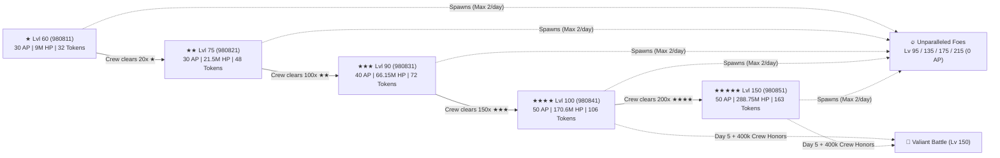

# Dread Barrage (`teamforce`) Architecture, Raid Mapping & Automation Guide

## 1. Executive Summary & Internal GBF Architecture

**Dread Barrage** (Japanese: ドレッドバラージュ) is Granblue Fantasy's cooperative crew raid and token drawbox event introduced as a lower-stress counterpart to *Unite and Fight* (Guild War). Internally within the Granblue Fantasy FuelPHP backend and Backbone/RequireJS frontend, Dread Barrage is identified by the module codename **`teamforce`**.

| Property | Value |
| :--- | :--- |
| **Internal Module Codename** | `teamforce` |
| **Event ID Series** | `16001` – `16015+` (`teamforce001` – `teamforce015+`) |
| **Active Iteration (#15)** | `event_id: 16015` (`teamforce15`) — Oct 22–29, 2026 (Earth Bosses / Wind Advantage) |
| **Primary Route** | `https://game.granbluefantasy.jp/#event/teamforce` |
| **Top Content XHR Endpoint** | `GET /teamforce/top/content/index` |
| **Valor Badge Item ID** | `91001` (Exchange at `#event/teamforce/medal`) |
| **Victory Certificate Item ID** | `10360` (Exchange at `#event/teamforce/bill`) |
| **Event Token Item ID** | `90009` (Drawbox at `#event/teamforce/gacha`) |

---

## 2. Route Anatomy, XHR/REST Endpoints & DOM Selectors

### 2.1 Client Router (`event/teamforce/router/teamforce-router.js`)

The client router maps `#event/teamforce/:view(/:param)` across 14 views in `event/common/teamforce/view/`:

| Route Hash | View Module | Controller / Action | Purpose |
| :--- | :--- | :--- | :--- |
| `#event/teamforce` | `view/top` | `teamforce/top/content/index` | Main event hub, raid selection (`normal`, `hell`, `strong`), Valiant Battle, and missions |
| `#event/teamforce/reward` | `view/reward` | `teamforce/reward/content/index` | Battle Badge (`defeat`) and Crew/Individual Honor (`point`) reward lists |
| `#event/teamforce/enemy_reward` | `view/enemy_reward` | `teamforce/enemyreward/content/index` | Valiant Battle first-time victory animation (`#cjs-valiantbattle-win`) |
| `#event/teamforce/enemy_reward_result` | `view/enemy_reward_result` | `teamforce/enemyreward/content/result` | Valiant Battle first-time victory loot summary |
| `#event/teamforce/medal` | `view/medal` | `teamforce/reward/content/medal` | Valor Badge (`91001`) exchange shop |
| `#event/teamforce/bill` | `view/bill` | `teamforce/reward/content/bill` | Victory Certificate (`10360`) exchange shop |
| `#event/teamforce/gacha` | `view/gacha` | `teamforce/gacha/content/index` | Token Drawbox main page (redirects to `gacha_setting` if no reset target is set) |
| `#event/teamforce/gacha_setting` | `view/gacha_setting` | `teamforce/gacha/content/setting` | Select Drawbox reset target (Revenant Weapon, New World Quartz, or Crystallized Core) |
| `#event/teamforce/gacha_result` | `view/gacha_result` | `rest/teamforce/gacha/result` | Token Drawbox draw results & box reset controls |
| `#event/teamforce/gacha_lineup` | `view/gacha_lineup` | `teamforce/gacha/content/lineup` | Full contents of current Token Drawbox |
| `#event/teamforce/title` | `view/title` | `teamforce/title/content/index` | Event trophies & titles |
| `#event/teamforce/performance` | `view/performance` | `teamforce/performance/content/index` | Crew & individual honor/defeat rankings |

### 2.2 REST API Endpoints (`event/common/teamforce/model/index.js`)

| Endpoint | Method | Payload / Params | Description |
| :--- | :--- | :--- | :--- |
| `/teamforce/top/content/index` | `GET` | `?_=<ts>&uid=<uid>` | Returns `option.boss_list`, `quest_list`, `hell_list`, `poped_extra_enemy_list`, `specialbattle_info`, `mission_list`, `guild_mission_list`, `user_event_point`, `guild_event_point`, `user_medal_count`, `user_bill_count` |
| `/rest/teamforce/reward/defeat_reward/:page` | `GET` | `page = 1..N` | Lists Battle Badge (`defeat`) rewards and `can_receive_count` |
| `/rest/teamforce/reward/receive_all_defeat_reward` | `POST` | `{ special_token: null }` | Claims all completed Battle Badge rewards in one call |
| `/rest/teamforce/reward/point_reward/:page` | `GET` | `page = 1..N` | Lists Crew & Individual Honor (`point`) rewards and `can_receive_count` |
| `/rest/teamforce/reward/receive_all_point_reward` | `POST` | `{ special_token: null }` | Claims all completed Honor rewards in one call |
| `/rest/teamforce/gacha/bulk_box_play` | `POST` | `{ special_token: null }` | Draws up to an entire box (or multiple boxes via `gacha_bulk_box_count`) at once |
| `/rest/teamforce/gacha/play` | `POST` | `{ special_token: null }` | Uses all available tokens up to the box limit |
| `/rest/teamforce/gacha/bulk_play` | `POST` | `{ special_token: null }` | Standard multi-draw |
| `/rest/teamforce/gacha/reset_box` | `POST` | `{ box_id, special_token: null }` | Resets the current drawbox after pulling the reset target |
| `/rest/teamforce/gacha/weapon_set` | `POST` | `{ set_reset_trigger_id, set_reset_trigger_kind }` | Sets the Drawbox reset target (Revenant Weapon, NWQ, or Crystallized Core) |
| `/rest/teamforce/top/boss_raid` | `GET` | `?_=<ts>&uid=<uid>` | Checks/initiates the Crew Valiant Battle raid |
| `/rest/teamforce/top/one_shot_assist` | `POST` | `{ is_check: 0\|1 }` | Toggles Special Backup (One-Shot Kill) setting |

### 2.3 Verified DOM Selectors

- **Raid Selection (`#event/teamforce`)**:
  - `.prt-enemy-info-list .btn-start-quest.open` — Direct raid start button (carries `data-quest-id`, `data-ap`, `data-chapter-id`).
  - `.cnt-teamforce .btn-quest-select[data-quest-group="normal"|"hell"|"strong"]` — Opens `.pop-teamforce-quest-list` modal containing `.pop-teamforce-quest-list .btn-start-quest.open`.
  - `.pop-release-quest .btn-usual-close, .pop-release-quest .btn-usual-ok` — Dismisses new boss tier unlock modal.
- **Valiant Battle (`#event/teamforce`)**:
  - `.cnt-teamforce .btn-valiant-battle` -> `.pop-valiant-battle .btn-usual-ok` -> `.pop-attribute-description .btn-usual-ok`.
- **Rewards (`#event/teamforce/reward`)**:
  - `.btn-tabs[data-reward-type="defeat"]` (Battle Badges tab) & `.btn-tabs[data-reward-type="point"]` (Crew Honors tab).
  - `.prt-get-all-wrapper .btn-reward-get-all` (Claim All) & `.prt-reward-list-wrapper .btn-reward-get` (Claim Single).
- **Token Drawbox (`#event/teamforce/gacha`)**:
  - `.prt-event-gacha .btn-bulk-play-box:not(.disable)` (Draw Box)
  - `.prt-event-gacha .btn-use-all:not(.disable)` (Use All Tokens)
  - `.prt-event-gacha .btn-bulk-play:not(.disable)` (Multi-Draw)
  - `.prt-event-reset .btn-reset` -> `.pop-reset-confirm .btn-usual-ok` -> `.pop-reset .btn-usual-ok` (Reset Box)

---

## 3. Complete Enemy Quest & Raid Mapping

### 3.1 Standard Crew Raids (`1★` to `5★`) — Iteration #15 (Oct 2026, Earth / Wind Adv)

All standard Dread Barrage raids cost **0 host materials** (AP only) and can be launched directly via `https://game.granbluefantasy.jp/#quest/supporter/<QUEST_ID>/1`.

| Tier | Category | Quest Group | Quest ID | Chapter ID | Boss Name (Oct 2026 Earth) | Cost (Host / Join) | Est. HP | Solo Honors | Badges (Solo) | Tokens (Host / MVP / 2nd / 3rd / Join / **Solo Total**) | Unlock Requirement | Unparalleled Spawn Rate | Recommended Strategy |
| :--- | :---: | :---: | :---: | :---: | :--- | :---: | :---: | :---: | :---: | :---: | :--- | :---: | :---: |
| **1★** | `★` | `normal` | `980811` | `98081` | **Lvl 60 Lacerta Currens** | 30 AP / 2 EP | 9,000,000 | ~320 | 2 | 18 / 14 / — / — / 20 (**32**) | Unlocked at start | Every 10 clears | `otk_0b` (Quick Summon) |
| **2★** | `★★` | `normal` | `980821` | `98082` | **Lvl 75 Ferrum Agile** | 30 AP / 2 EP | 21,500,000 | ~788 | 2 | 28 / 20 / — / — / 22 (**48**) | 20× `★` crew clears | Every 10 clears | `otk_0b` (Best OTK Tokens/sec) |
| **3★** | `★★★` | `hell` | `980831` | `98083` | **Lvl 90 Corpus Volans** | 40 AP / 2 EP | 66,150,000 | ~3,730 | 2 | 50 / 22 / 15 / 8 / 25 (**72**) | 100× `★★` crew clears | Every 5 clears | `otk_1t` (Quick Summon + Attack) |
| **4★** | `★★★★` | `hell` | `980841` | `98084` | **Lvl 100 Ferrum Grave** | 50 AP / 3 EP | 170,625,000 | ~20,330 | 2 | 72 / 34 / 26 / 18 / 40 (**106**) | 150× `★★★` crew clears | Every 3 clears | `smart_fa` (Smart Full Auto) |
| **5★** | `★★★★★` | `hell` | `980851` | `98085` | **Lvl 150 Arx Movens** | 50 AP / 3 EP | 288,750,000 | ~41,000 | 2 | 115 / 48 / 40 / 28 / 80 (**163**) | 200× `★★★★` crew clears | Every 2 clears | `smart_fa` (Best Honors + Tokens) |

### 3.2 Unparalleled Foes (`poped_extra_enemy_list` / `strong`)

Clearing standard `1★`–`5★` quests fills a hidden gauge that spawns an **Unparalleled Foe** (強敵). Each player can host up to **2 Unparalleled Foes per day** (resets at 05:00 JST). Backup requests can only be sent to **Crew Members**.

- **Special Backup (One-Shot Kill)**: Once per day (charges at the start of the event and resets daily at 05:00 JST; max 2 charges stored), the host or a joining crew member can trigger **Special Backup** (`is_active_one_shot_kill`), where a special ally immediately executes a **One-Hit KO** regardless of remaining boss HP.

| Tier | Level | Quest ID (Pattern) | Cost (Host / Join) | Est. HP | Solo Honors | Badges | Tokens (Host / MVP / Join / **Solo Total**) | Unlock Schedule |
| :--- | :---: | :---: | :---: | :---: | :---: | :---: | :---: | :--- |
| **Unparalleled I** | **Lv 95** | `980861` | 0 AP / 3 EP | ~131,000,000 | ~5,500 | 3 | 80 / 30 / 40 (**110**) | Day 1 (19:00 JST) |
| **Unparalleled II** | **Lv 135** | `980871` | 0 AP / 3 EP | 245,437,500 | ~11,855 | 4 | 120 / 40 / 60 (**160**) | Day 3 (19:00 JST) |
| **Unparalleled III** | **Lv 175** | `980881` | 0 AP / 3 EP | 375,375,000 | ~24,000 | 5 | 160 / 50 / 80 (**210**) | Day 4 (19:00 JST) |
| **Unparalleled IV** | **Lv 215** | `980891` | 0 AP / 3 EP | 924,000,000 | ~75,000 | 6 | 240 / 80 / 120 (**320**) | Day 5 (19:00 JST) |

### 3.3 Valiant Battle (`specialbattle_info`)

The **Valiant Battle** (バリアントバトル) is a special Lv 150 crew raid that unlocks on **Day 5 at 19:00 JST** once the crew reaches **400,000 Crew Honors** (`special_battle_contribution_point: "400000"`).

- **First-Time Clear Rewards (`special_battle_clear_reward`)**:
  - `1×` **Damascus Crystal** (`item_kind: 10, item_id: 203`)
  - `1×` **Dread Barrage SSR Weapon Ticket** (`item_kind: 8, item_id: 118011`)
  - `30×` **Half Elixirs** (`item_kind: 4, item_id: 2`)
  - `90×` **Soul Berries** (`item_kind: 4, item_id: 5`)
  - `3×` **Elemental Earrings** (`item_kind: 73, item_id: 13` — Brickearth/Wind/etc. matching iteration)
  - `200×` **Elemental Quartz** (`item_kind: 10, item_id: 5031`)
  - `1×` **Sublimity Ring** (`item_kind: 73, item_id: 4`)
  - `4,000×` **Dread Barrage Tokens** (`item_kind: 22, item_id: 90009`)

---

## 4. Missions, Rewards, Valor Badges & Token Drawbox Economy

### 4.1 Event & Crew Missions (`mission_list` & `guild_mission_list`)

| Mission ID | Scope | Target | Star 1 | Star 2 | Star 3 | Star 4 |
| :---: | :---: | :--- | :--- | :--- | :--- | :--- |
| **#1** | Individual | Clear `★` Quest | 5 clears: **30 Crystals** | 10 clears: **50 Crystals** | 15 clears: **Island Builder Set ×1** | 20 clears: **100 Crystals** |
| **#2** | Individual | Clear `★★` Quest | 5 clears: **30 Crystals** | 10 clears: **50 Crystals** | 15 clears: **Island Builder Set ×1** | 20 clears: **100 Crystals** |
| **#3** | Individual | Clear `★★★` Quest | 5 clears: **100 Crystals** | 10 clears: **200 Crystals** | 15 clears: **Island Builder Set ×1** | 20 clears: **Draw Ticket ×1** |
| **#4** | Crew (`guild`) | Defeat Unparalleled Foes | 10 clears: **150 Crystals** | 30 clears: **Intricacy Ring ×1** | 80 clears: **Draw Ticket ×1** | 150 clears: **Elemental Earrings ×2** |

### 4.2 Battle Badge (`defeat`) & Honor (`point`) Rewards

1. **Battle Badge Rewards (`/rest/teamforce/reward/defeat_reward/:page`, 1 to 400 Badges)**:
   - Awards Rupies, Half Elixirs, Soul Berries, Omega Anima, CP, Dread Barrage Tokens, Crystals, and Victory Certificates.
2. **Crew & Individual Honor Rewards (`/rest/teamforce/reward/point_reward/:page`)**:
   - **Valor Badges (`item_id: 91001`)**: Up to **260 Valor Badges** from combined Crew + Individual Honor milestones (up to `1,500,000` Crew Honors & `100,000`–`1,400,000` Individual Honors), plus **40 Valor Badges** from the Treasure Trade shop (**300 Valor Badges total** per event).
   - **Victory Certificates (`item_id: 10360`)**: Up to **8+ Certificates** from Honor milestones (`point_reward_bill_guide`), tradable at `#event/teamforce/bill`.
   - **Special Honor Milestones (`unreceived_special_reward_list`)**:
     - `10,500,000` Crew Honors + `600,000` Individual Honors: **500 Crystals**
     - `21,000,000` Crew Honors + `1,400,000` Individual Honors: **1× Premium Draw Ticket**
     - `45,000,000` Crew Honors + `1,400,000` Individual Honors: **1,000 Crystals**

### 4.3 Token Drawbox Economy (`#event/teamforce/gacha`)

| Box Range | Cost per Draw | Items per Box | Tokens per Full Box | Early Reset Allowed? | Selectable Reset Targets (`#event/teamforce/gacha_setting`) |
| :--- | :---: | :---: | :---: | :---: | :--- |
| **Boxes 1 – 4** | **2 Tokens** | 2,040 | **4,080 Tokens** | **Yes** (upon pulling Reset Target) | Revenant Weapon, New World Quartz, or Crystallized Core |
| **Boxes 5 – 20** | **2 Tokens** | 2,040 | **4,080 Tokens** | **No** (must empty all 2,040 items) | Revenant Weapon, New World Quartz, or Crystallized Core |
| **Boxes 21 – 40** | **4 Tokens** | ~2,000 | **~8,000 Tokens** | **No** | Revenant Weapon only (forced) |
| **Boxes 41+** | **6 Tokens** | ~2,000 | **~12,000 Tokens** | **No** | Revenant Weapon only (forced) |

> [!TIP]
> Clearing **Boxes 1–20** requires at most **81,600 Tokens** (~500 solo clears of `5★` or ~1,700 solo clears of `2★`) and is the highest-efficiency token milestone in the event.

---

## 5. Automation Workflows & CLI Commands

### 5.1 Dedicated Dread Barrage Engine (`src/cli/run-dread-barrage.ts`)

| Command | Description |
| :--- | :--- |
| `bun run db:status` | Queries `/teamforce/top/content/index` and displays the live telemetry dashboard (Open/Locked tiers, Clear counts, Honors, Valor Badges, Unparalleled Foes, Missions) |
| `bun run db:1star [runs]` | Farms `1★` (`980811`) with 0b Quick Summon OTK and automatic Unparalleled Foe interception |
| `bun run db:2star [runs]` | Farms `2★` (`980821`) with 0b Quick Summon OTK (highest OTK Token/sec speed-farm) |
| `bun run db:3star [runs]` | Farms `3★` (`980831`) with 1T Quick Summon + Attack |
| `bun run db:4star [runs]` | Farms `4★` (`980841`) with Smart Full Auto + reload skip |
| `bun run db:5star [runs]` | Farms `5★` (`980851`) with Smart Full Auto + reload skip (automatically farms `4★` first if `5★` is still locked!) |
| `bun run db:unparalleled` | Hosts and clears active spawned Unparalleled Foes (`0 AP`, up to 2/day) |
| `bun run db:valiant` | Initiates and clears the Crew Valiant Battle if unlocked |
| `bun run db:missions` | Automatically completes all individual `1★`, `2★`, and `3★` 20-clear missions and claims rewards |
| `bun run db:rewards` | Claims all pending Battle Badge (`defeat`) and Honor (`point`) rewards via REST |
| `bun run db:gacha` | Empties Dread Barrage Token Drawboxes on `#event/teamforce/gacha` |
| `bun run db:all` | Runs the complete end-to-end Dread Barrage pipeline (Status -> Missions -> Raid Loop -> Unparalleled -> Valiant -> Rewards -> Drawbox) |

### 5.2 Declarative Workflow Templates (`UniversalWorkflowEngine`)

- [`templates/dread-barrage-1star-otk.json`](file:///C:/laragon/www/guranburuing/templates/dread-barrage-1star-otk.json) (`bun run dread-barrage-1star-otk`)
- [`templates/dread-barrage-2star-otk.json`](file:///C:/laragon/www/guranburuing/templates/dread-barrage-2star-otk.json) (`bun run dread-barrage-2star-otk`)
- [`templates/dread-barrage-3star-otk.json`](file:///C:/laragon/www/guranburuing/templates/dread-barrage-3star-otk.json) (`bun run dread-barrage-3star-otk`)
- [`templates/dread-barrage-4star-fa.json`](file:///C:/laragon/www/guranburuing/templates/dread-barrage-4star-fa.json) (`bun run dread-barrage-4star-fa`)
- [`templates/dread-barrage-5star-fa.json`](file:///C:/laragon/www/guranburuing/templates/dread-barrage-5star-fa.json) (`bun run dread-barrage-5star-fa`)
