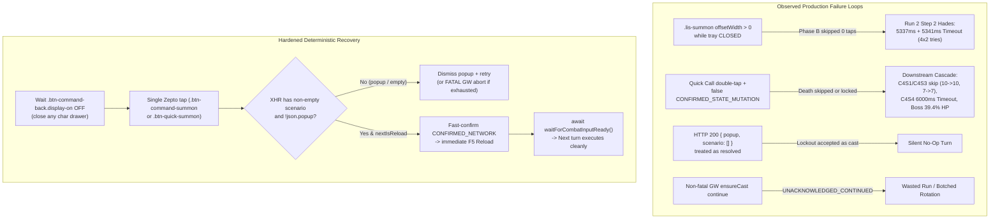

# Root Cause Analysis: Combat Failures, Success Factors & Verification Guardrails

An evidence-backed engineering post-mortem of Guild War / combat automation failures in `gbf-remote-controller`, detailing **7 verified root causes**, **exact code fixes (plus 1 open scaling bottleneck)**, **success vs. failure factors**, and a **False Positive / False Negative guardrail matrix** so future debugging isolates the true bug in one pass without misleading telemetry.

> **Verification Discipline:** Every claim below cites observed live logs, `data/step-audit-ledger.json` (`2026-11-24T03:27:49.435Z`), or verified source lines. Fixes applied after the last live run are explicitly marked as **pending live `--runs 2` confirmation**.

---

## Executive Architecture: Failure Loops vs. Deterministic Flow

---

## 1. Catalog of Observed Errors & Solutions

### RC-1: Summon Tray False-Open (`offsetWidth > 0` on Closed `.lis-summon`)
- **Evidence (Failure):**
  - Run 2 log (`gw-nm150-dark`, fresh 100% HP fight `#result_multi` -> `#quest/supporter/980701/1/0/10116`):
    `[Enforcer] Summon slot 6 detail popup did not open on attempt 1/4..3/4` -> `FAILED_TIMEOUT | Attempts: 4 | 5337ms` -> outer recovery `5341ms` -> `[FATAL] Mandatory Ensured GW Step 2`.
  - Earlier Run 1 log: Hades skipped in `12ms` (`unavailable in tray`).
- **Mechanism:** Live GBF CSS slides `.prt-command-summon` off-screen rather than setting `display: none`. Tray children (`.lis-summon`) retain `offsetParent !== null` and `offsetWidth > 0` even when closed. Checking `slotEl.offsetWidth > 0` caused Phase B (`handleSummon`) to evaluate `isSummonOpen = true` and tap `.btn-command-summon` **0 times**.
- **Solution (`[combat-execution.service.ts](file:///c:/laragon/www/guranburuing/src/engines/universal/combat-execution.service.ts)` `handleSummon`):**
  - Phase A waits until `.btn-command-back.display-on` is OFF (closing any prior character drawer without trusting `.lis-summon` geometry).
  - Phase B taps `.btn-command-summon`, waits strictly for `.btn-command-back.display-on` / `.summon-on` / `.summon-show`, pauses `60ms` (turbo) / `100ms` (normal) for slide-in settle, then taps `.lis-summon` (falling back to `humanizedClick` on `summonAttempt >= 2`).
- **Evidence (Verification Status):**
  - Step 2 Hades previously passed Attempt 1 in `1472ms` (`HEALTHY`, ledger `2026-11-24T03:27:49.435Z`), then regressed on fresh Run 2 until `.lis-summon` width checks were removed from Phase A/B.
  - Latest `handleSummon` patch passes `bun run typecheck` + `bun run workflow:validate`; **pending live `--runs 2` confirmation**.

### RC-2: Death / Swap Summon Failure & Downstream Skill Cascade
- **Evidence (Failure):**
  - Live log after failed Step 12 `SUMMON Slot 3 ("Death")`:
    - Step 13/14 `Hexcat's Echoing Fellwind +` skipped (`Recast: 10->10`), `The Emerald's Mischief` skipped (`Recast: 7->7`).
    - Step 15 `C4S4` timed out (`FAILED_TIMEOUT | 6033ms` + `6014ms`).
    - Step 16/17 `War Eternal +` (`10->10`) and `Wages of Sin +` (`6->6`) skipped.
    - Boss Demeter survived burst at `113,724,403 / 288,750,000 (39.4%)`.
- **Mechanism:** Death performs a two-part mechanic: KOs Character 4 (bringing in backline Nier with 4 skills, unlocking `C4S4`) and triggers ally-KO cooldown resets. In prior code, static `stage.pJsnData` still showed the pre-swap C4 name for ~2s, causing `deathSwapFailed` to falsely override a valid `summon_result.json` or fail to sync swapped units via `F5` reload.
- **Solution:**
  - Never override `serverConfirmedSummon` (`netRes.resolved && hasValidScenario`) using pre-reload `stage.pJsnData`.
  - Use `nextIsReload` fast-confirm when `reload` follows `summon` or `quick_call` so `F5` cancels Death's animation and loads fresh `start.json` with Nier mounted.
  - `StepExecutionMonitorService.diagnoseReceipts()` detects `summon` / `quick_call` Death failures crossing up to 1 post-summon `reload` and groups downstream skill skips/C4S4 timeouts under `FAILED_CHARACTER_SWAP_CASCADE`.
- **Evidence (Verified Live Success — `data/step-audit-ledger.json` `2026-11-24T03:27:49.435Z`):**
  - Step 13 `QUICK_CALL (Death, Ensured)`: `CONFIRMED_NETWORK` | Attempt 1 | `2542ms` | `HEALTHY`
  - Step 14 `RELOAD (F5)`: `1625ms` | `HEALTHY`
  - Step 15 `C4S1 ("World of Death and Love +")`: `1184ms` | Attempt 1 | `HEALTHY`
  - Step 16 `C4S3 -> C1 ("Last Love")`: `4625ms` | Attempt 1 | `HEALTHY`
  - Step 17 `C4S4 ("Eternal Vow")`: `2148ms` | Attempt 1 | `HEALTHY`
  - Steps 18–21 (`War Eternal +`, `Wages of Sin +`, `Diva Satanica`, `Gate of Demons +`): **100% Attempt 1, `0` skips, `0` failures.**

### RC-3: Quick Call Double-Tap Lockout, False Confirmation, & Silent GW Skip
- **Evidence (Defect Observed in Code Audit):**
  - Prior `handleQuickCall` called BOTH `humanizedClick(this.page, qBtn)` AND `qBtn.evaluate(tap + click)` on the same attempt.
  - If `netRes.resolved` was `false` (3500ms timeout) and HP did not drop, line 3218 unconditionally logged `CONFIRMED_STATE_MUTATION`, `verified: true`, and returned `true`.
  - If `.btn-quick-summon` was momentarily covered or unavailable on Attempt 1, `SKIPPED_COOLDOWN` returned `true` even in GW (`ensureCast: true`).
- **Solution (`handleQuickCall` in `combat-execution.service.ts`):**
  - Phase A waits up to `1200ms` (turbo) for `.btn-command-back.display-on` OFF (closing Step 11 `C4S1` drawer) before scanning `.btn-quick-summon`.
  - Single Zepto `tap` on Attempt 1 (`humanizedClick` fallback on retries).
  - `nextIsReload && serverConfirmed` fast-confirm (`CONFIRMED_NETWORK`, `Recast: 0->used`).
  - Unconfirmed `ensureCast: true` retries up to `maxAttempts` (4) instead of faking confirmation; unavailable GW ensured Quick Call returns `false` (`FAILED_TIMEOUT`) instead of `SKIPPED_COOLDOWN`.
- **Evidence (Verification Status):** Hardened `handleQuickCall` passes `bun run typecheck` + `bun run workflow:validate`; **pending live `--runs 2` confirmation**.

### RC-4: HTTP 200 `{ popup, scenario: [] }` Treated as Successful Server Confirmation
- **Mechanism:** When Cygames rejects an action due to turn lockout or concurrent access, `ability_result.json` / `summon_result.json` often returns **HTTP 200** with `{ popup: {...}, scenario: [] }` instead of an HTTP 4xx/5xx error. Treating any HTTP 200 as `resolved: true` caused silent no-op steps.
- **Solution (`[combat-resolution.service.ts](file:///c:/laragon/www/guranburuing/src/engines/universal/combat-resolution.service.ts)` `waitForNetworkResponseAndPayload`):**
  - Requires `hasNonEmptyScenario = Array.isArray(json?.scenario) && json.scenario.length > 0`.
  - Returns `{ resolved: false, json, isPopupLockout: true }` whenever `(json.popup && !hasNonEmptyScenario) || json.result === 'ng' || json.error`.

### RC-5: Mandatory GW Failure Treated as Non-Fatal (`UNACKNOWLEDGED_CONTINUED`)
- **Evidence (Failure):**
  - Live failure logs where Step 12 Death failed (`0/4` tries), yet the engine logged `⚠️ Non-fatal combat action failure... Continuing combat pipeline` and attacked Demeter down to `60.7%` or `39.4%` HP before triggering fruitless cleanup attacks.
- **Solution (`[universal-workflow.engine.ts](file:///c:/laragon/www/guranburuing/src/engines/universal-workflow.engine.ts)`):**
  - `isFatalGwEnsuredStep = Boolean(this.isGuildWarQuest() && step.ensureCast)` (plus `isMandatoryDeathSummon` covering both `summon` and `quick_call`) sets `fatalStepAbort = true` and `stopRequested = true`, immediately halting the pipeline.
- **Evidence (Verified Live):** Run 2 Hades timeout immediately logged `🚨 [FATAL] Mandatory Ensured GW Step 2 ... Flagging as FATAL and aborting GW combat pipeline` and moved browser to standby.

### RC-6: Post-Attack Reload Lockout Contention (`RETRY_HEAVY` vs. Client Hydration)
- **Evidence (`data/step-audit-ledger.json` `2026-11-24T03:27:49.435Z`):**
  - **Step 9 `C4S3` (immediately after Step 8 `Attack -> Reload`):** `3728ms`, `totalExtraAttempts: 3` (`RETRY_HEAVY`).
  - **Step 12 `C4S1` (immediately after Step 11 `Attack -> Reload`):** `3021ms`, `totalExtraAttempts: 3` (`RETRY_HEAVY`).
  - **Step 15 `C4S1` (immediately after Step 14 `Quick Call -> Reload`):** `1184ms`, `0` extra attempts (`HEALTHY`).
- **Mechanism:** `handleReload` already awaits `waitForCombatInputReady`, so post-`Quick Call` reload unlocks on Attempt 1. After an **Attack**, however, Cygames enforces an **account-wide server lockout timer** (~`1.01s` base + Normal/CA chain duration). `C4S3` and `C4S1` hit the tail end of server attack lockout after F5 finishes; the existing popup-dismiss/retry loop handles it cleanly in 1 step invocation (~3.0–3.7s).

### RC-7 `[RESOLVED — PENDING LIVE VERIFICATION]`: Synchronous Per-Step Audit Ledger Disk Flush & Quiet Mode
- **Evidence (`[step-execution-monitor.service.ts](file:///c:/laragon/www/guranburuing/src/engines/universal/step-execution-monitor.service.ts)`):**
  - Previously, `recordStepReceipt()` called `this.persistSessionAuditLedger()` on **every single step** (`fs.readFileSync` + `JSON.parse` + $O(N)$ `aggregateHotspots(allSessionReceipts)` + `Math.max(...receipts.map(...))` + `fs.writeFileSync`).
  - `CombatExecutionService` also logged `getAndLogEnemyHp()` after every cast/reload even after `captureCombatSnapshot()` (`postState`) read HP.
- **Solution:**
  - Switched `StepExecutionMonitorService` to **$O(1)$ per-step rolling aggregation** (`rollingByStep`) sharing `computeHotspotHealth`, bounded `sessionStepReceipts` to the last 500 entries, and moved disk flushes out of `recordStepReceipt()` into `finalizeRun()` (per-run in `verbose`, every 10 runs + immediately on degraded/stop/exit in `summary`, skipped in `off`).
  - Added `telemetryMode?: 'verbose' | 'summary' | 'off'` (`--quiet` / `-q` or `--telemetry=summary|off|verbose`), printing **1 line per completed run** while keeping all errors, warnings, Enforcer retries, and GW fatal aborts always visible.
  - Added pipeline-hash-keyed auto-promotion (`telemetryAutoQuietRuns`, default `100` consecutive clean runs in `data/step-audit-ledger.json`): battle-tested workflows auto-promote to `summary` and automatically revert to `verbose` if `template.steps` changes.

---

## 2. Success Factors vs. Failure Factors

| Dimension | Success Factors (Verified Stable) | Failure Factors (Observed Breakdowns) |
| :--- | :--- | :--- |
| **Drawer / HUD State** | Deterministic state transitions: check `.btn-command-back.display-on` OFF before HUD actions; confirm tray via `.btn-command-back.display-on` / `.summon-on` | Relying on `.lis-summon` `offsetWidth > 0` or `offsetParent !== null` (remains non-zero when closed) |
| **Input Dispatch** | Single Zepto `tap` after `createjs.Tween.tick`, `humanizedClick` fallback reserved strictly for retry attempts | Double-dispatching `humanizedClick` + `evaluate(tap + click)` on the same attempt (triggers double-tap popups) |
| **Popup Confirmation** | Explicit modal OK selector `.pop-summon-detail .btn-usual-ok.btn-summon-use` | Bare `.btn-summon-use` (matches background tray cards, never confirms detail popup) |
| **Server Truth** | Require valid non-empty `json.scenario` and `!json.popup`; never override server confirmation with pre-reload `pJsnData` | Accepting HTTP 200 `{ popup, scenario: [] }`, or faking `CONFIRMED_STATE_MUTATION` when XHR timed out |
| **Reload Timing** | Fast-confirm on `serverConfirmed` before `reload`, await `waitForCombatInputReady` after F5 | Polling full `2.6s` animations before F5, or firing Turn N+1 skills before client buttons hydrate |
| **GW Safety** | Fatal abort on any `ensureCast: true` failure in GW; clear every result (`confirm_result`) due to 1-pending-battle cap | Treating failed Death/Hades as `UNACKNOWLEDGED_CONTINUED` or skipping on transient cooldown |
| **Verification** | `bun run typecheck` + `workflow:validate` + **>= 2 consecutive fresh `--runs 2` live runs** + `bun run step:audit` | Claiming `"fixed"` from mock-DOM tests, `--dry-run`, or a single resumed mid-turn Run 1 |

---

## 3. False Positive & False Negative Verification Matrix

Always cross-check telemetry against this table so you neither **chase phantom bugs (False Positives)** nor **ship broken fixes (False Negatives)**.

### 3.1 False Positives (Telemetry Looks Bad, Actually Expected Behavior)

| Signal Observed | Why Agents Misdiagnose It | Ground-Truth Explanation & Evidence |
| :--- | :--- | :--- |
| **`Recast: 0->0` + `noopMutationCount: 1` on `CONFIRMED_NETWORK` buff skill** | Agents think the skill failed to go on cooldown | Non-damaging buff skills (`War Eternal +`, `Eternal Vow`, `Gate of Demons +`) resolve `ability_result.json` cleanly on server (`CONFIRMED_NETWORK`) while `pJsnData` / snapshot reads remain `0` pre-reload. Proven on Steps 3–6, 15, 17–21 in live ledger (`2026-11-24T03:27:49.435Z`). **Do not patch unless `status` is `FAILED_TIMEOUT` or `SKIPPED_COOLDOWN`.** |
| **`RETRY_HEAVY` (3 extra taps) strictly on first skill after `Attack -> Reload`** | Agents assume skill drawer selector or `handleReload` hydration is broken | Step 9 (`C4S3`, `3728ms`) and Step 12 (`C4S1`, `3021ms`) retry after `Attack -> Reload` because of **account-wide server attack lockout**, whereas Step 15 (`C4S1`, `1184ms`, Attempt 1 `HEALTHY`) after `Quick Call -> Reload` has 0 retries. Retry loop absorbs lockout cleanly. |
| **`SKIPPED_COOLDOWN (turn_limit)` on Turn 1 Summon in a resumed mid-battle Run 1** | Agents panic thinking `handleSummon` skipped Turn 1 Hades | In resumed Run 1 (`HP: 284,668,416 / 288,750,000 = 98.6%`), a summon had already been called on Turn 1 (`summon_enable === 0`). Only abnormal when Turn 1 is at 100.0% HP with `summon_enable === 1`. |
| **`C4S4` `FAILED_TIMEOUT (6000ms)` or `War Eternal +` skipped downstream** | Agents tweak C4S4 selectors or C2 cooldown timers | Cascade victim of failed upstream Death/swap summon or missing post-swap `reload` (unswapped Ewiyar has 3 skills and no ally-KO reset). Trace upstream to earliest failed step (`RC-2`). |
| **`stage.pJsnData` still shows pre-swap C4 name right after Death `summon_result.json`** | Code thinks Death didn't swap in Nier and retries 4–7x | `stage.pJsnData` only updates on `start.json` reload. Server `summon_result.json` with `scenario.length > 0 && !popup` is authoritative. |

### 3.2 False Negatives (Looks Passing / Ready, Actually Broken)

| Signal That Looks "Green" | Hidden Failure Mechanism | Mandatory Counter-Check |
| :--- | :--- | :--- |
| **`.lis-summon` `offsetParent !== null && offsetWidth > 0`** | Element stays mounted off-screen when `.prt-command-summon` is closed -> Phase B skips clicking `.btn-command-summon` -> **Run 2 total failure (`5337ms`)** | Require `.btn-command-back.display-on` / `.summon-on` / `.summon-show` to verify summon tray state. |
| **HTTP 200 on `*_result.json` XHR** | Cygames sends `{ popup: {...}, scenario: [] }` on lockout rejections with HTTP 200 | Enforce `Array.isArray(json.scenario) && json.scenario.length > 0 && !json.popup` before setting `resolved: true`. |
| **`CONFIRMED_STATE_MUTATION` logged by old `handleQuickCall`** | Old fallback marked Quick Call `verified: true` even when `networkConfirmed: false` and `bossHp` didn't change | Require `serverConfirmed` OR explicit mutation (`qDmg > 0 || bossHpDropped || summonDisabledNow || btnNowUnavailable`); retry/abort if `ensureCast: true`. |
| **Resumed Run 1 passes cleanly while Run 2 fails** | Resumed Turn 1 skipped Turn 1 summon via `turn_limit` (`98.6%` HP), masking fresh-battle `handleSummon` bugs until Run 2 started at `100.0%` HP | Always validate combat changes with **>= 2 consecutive fresh 100% HP live runs** (`--runs 2`) + `bun run step:audit <workflow>`. |
| **Mock-DOM unit tests, `typecheck`, or `--dry-run` pass 100%** | Fake DOMs miss off-screen CSS layout, CreateJS tweens, Zepto handlers, and `{ popup }` XHR payloads | Treat local checks strictly as compile/schema gates — **never** claim `"all fixed"` without live CDP + `step:audit` proof (`SKILL.md` §10). |
