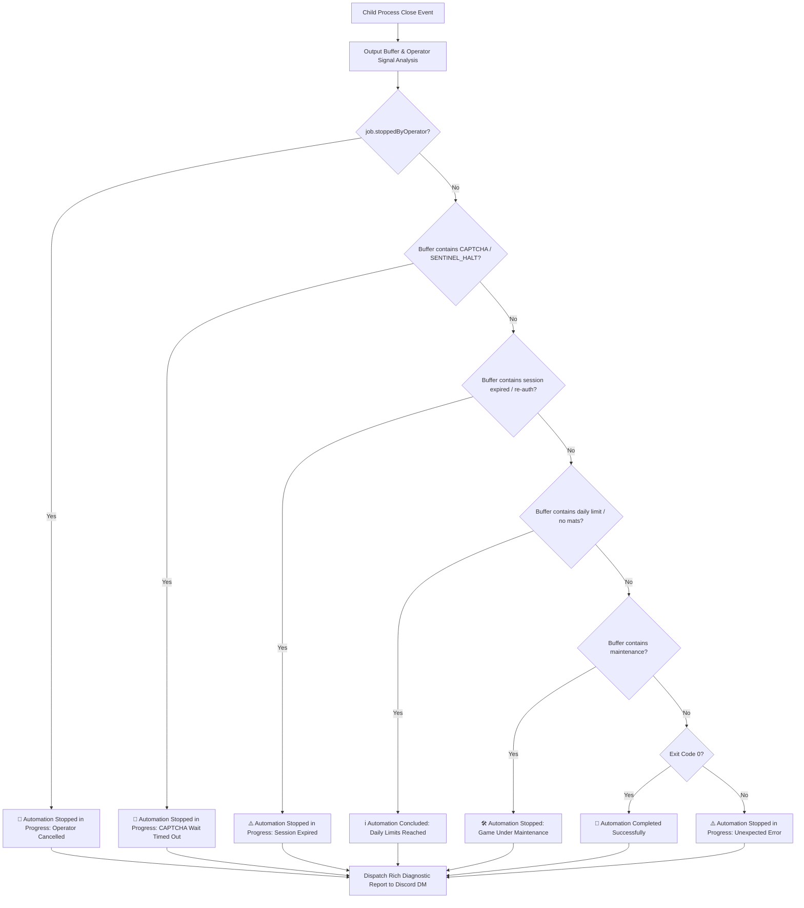

# Principle 14: VPS Remote Operations, ChatOps Gateway & Autonomous Scheduler

## 1. Executive Summary & Production Objectives

Deploying Granblue Fantasy automation to a remote cloud VPS (Virtual Private Server) introduces strict operational requirements:
1. **Unattended Resilience**: The system must run continuously 24/7, automatically reboot on server restart, and self-heal from transient network or Chrome CDP disconnects.
2. **Zero Inbound Attack Surface**: No open HTTP/WebSocket ports should be exposed to the public internet, preventing brute-force unauthorized control of the player's account.
3. **Hardware & Resource Throttling**: The entire runtime must operate reliably within budget VPS tiers (1 vCPU, 1 GB – 2 GB RAM) without triggering Linux Out-Of-Memory (OOM) killer events.
4. **Operator ChatOps Control**: Full remote management (task triggering, job halting, live terminal log streaming, and scheduler toggling) directly from a private mobile or desktop Discord DM session.
5. **JST Reset Alignment**: Daily farming tasks must fire autonomously at the exact Granblue Fantasy server reset boundary (`05:00:15 JST`) with sub-second precision and anti-drift synchronization.

---

## 2. Zero-Inbound-Port Network Topology

Traditional server web dashboards expose ports (e.g. 80, 443, 3000) that demand TLS certificates, reverse proxies, and continuous firewall maintenance. 

Instead, the **Granblue Remote Controller** employs an **Outbound-Only ChatOps Gateway**:

```
┌─────────────────────────────────────────────────────────────────────────────┐
│                             Ubuntu VPS Instance                             │
│                                                                             │
│   [Firewall: INBOUND BLOCKED]                                               │
│                                                                             │
│   ┌─────────────────────────────────────────────────────────────────────┐   │
│   │                      Unified VPS Daemon Process                     │   │
│   │                                                                     │   │
│   │   ┌─────────────────────────────────────────────────────────────┐   │   │
│   │   │            DiscordCommandGatewayService (Singleton)         │   │   │
│   │   │  • Initiates OUTGOING WebSocket to wss://gateway.discord.gg  │   │   │
│   │   │  • Subscribes strictly to Private DMs from DISCORD_USER_ID   │   │   │
│   │   │  • Discards all non-operator messages or bot echoes          │   │   │
│   │   └──────────────────────────────┬──────────────────────────────┘   │   │
│   │                                  │                                  │   │
│   │                                  ▼                                  │   │
│   │   ┌─────────────────────────────────────────────────────────────┐   │   │
│   │   │             ProcessRunnerService (Concurrency Gate)         │   │   │
│   │   │  • Exclusive Port 9222 Mutex Lock                           │   │   │
│   │   │  • Whitelist Command Spawner (No arbitrary shell injection) │   │   │
│   │   │  • Dual-Stream Logger (logs/automation.log + Memory Buffer) │   │   │
│   │   └──────────────────────────────┬──────────────────────────────┘   │   │
│   │                                  │                                  │   │
│   │                                  ▼                                  │   │
│   │   ┌─────────────────────────────────────────────────────────────┐   │   │
│   │   │             DailyResetScheduler (Autonomous Daemon)         │   │   │
│   │   │  • Mathematical 05:00:15 JST Countdown Loop                 │   │   │
│   │   │  • 5-Minute Advance Discord Warning Alerts                  │   │   │
│   │   │  • Anti-Duplicate Execution Guard (`lastExecutedGbfDay`)    │   │   │
│   │   └─────────────────────────────────────────────────────────────┘   │   │
│   └─────────────────────────────────────────────────────────────────────┘   │
└──────────────────────────────────────┬──────────────────────────────────────┘
                                       │ Outgoing WSS TLS
                                       ▼
                         ┌───────────────────────────┐
                         │   Discord Gateway Cloud   │
                         └─────────────┬─────────────┘
                                       │ Mobile / Desktop Push
                                       ▼
                         ┌───────────────────────────┐
                         │   Operator Discord DM     │
                         └───────────────────────────┘
```

### Key Security Properties:
- **Zero Open Ports**: The VPS firewall keeps all inbound ports (`22` allowed only for SSH key authentication). No attacker can probe or attack the bot over HTTP/REST.
- **Operator Snowflake Verification**: Every incoming message must have `msg.author.id === config.DISCORD_USER_ID`. Bot messages and third-party users are silently dropped before parsing.
- **Strict Command Whitelist**: Input strings are mapped to predefined `COMMAND_WHITELIST` script presets. Arbitrary shell arguments are strictly disarmed.

---

## 3. Single-Process Concurrency & Mutex Locking

Chrome's Chrome DevTools Protocol (CDP) on port `9222` can only be reliably manipulated by **one automation engine at a time**. Concurrent automation scripts attempting to attach to the same target page cause `Target.attachedToTarget` race conditions, frame detachments, and silent navigation abortion.

To prevent this:
1. `ProcessRunnerService` maintains an atomic mutex state:
   ```ts
   if (this.activeJob) {
     return {
       success: false,
       message: `⚠️ Process Concurrency Lock: Job ${this.activeJob.key} (PID ${this.activeJob.pid}) is currently running.`
     };
   }
   ```
2. Any operator attempt to trigger a second workflow while one is active is immediately rejected with uptime and PID diagnostics.
3. The operator can send `/gbf stop` (or `/halt`) to dispatch `SIGINT` (with a 4-second escalation to `SIGKILL`) to cleanly unjam the process and unlock port `9222`.

---

## 4. Autonomous Daily Reset Scheduler

Granblue Fantasy resets its daily limits, pro skips, and daily raid hosts at **05:00:00 JST (UTC+9)** every morning.

### 4.1 Chronological Drift Compensation
System clocks drift and Cygames backend daily reset batch scripts take between 5 to 15 seconds to fully propagate across all Japanese database shards.

The scheduler computes the exact next reset target using:
```ts
export function getNextDailyResetJst(bufferSeconds = 15, referenceDate: Date = new Date()): { nextResetDate: Date; msRemaining: number } {
  const jstOffsetMs = 9 * 60 * 60 * 1000;
  const nowJstMs = referenceDate.getTime() + jstOffsetMs;
  const nowJstDate = new Date(nowJstMs);

  let nextResetJstMs = Date.UTC(nowJstDate.getUTCFullYear(), nowJstDate.getUTCMonth(), nowJstDate.getUTCDate(), 5, 0, bufferSeconds);

  if (nowJstMs >= nextResetJstMs) {
    nextResetJstMs = Date.UTC(nowJstDate.getUTCFullYear(), nowJstDate.getUTCMonth(), nowJstDate.getUTCDate() + 1, 5, 0, bufferSeconds);
  }

  const nextResetRealUtcMs = nextResetJstMs - jstOffsetMs;
  return { nextResetDate: new Date(nextResetRealUtcMs), msRemaining: Math.max(0, nextResetRealUtcMs - referenceDate.getTime()) };
}
```

### 4.2 Scheduler Lifecycle States
```
     [Scheduler Initialized]
                │
                ├──► Send Advance Notification (5 mins before 05:00 JST)
                │
                ▼ (At 05:00:15 JST)
     [Acquire Concurrency Lock]
                │
                ├──► 1. Universal Pro Skips (Hard+, Omega, Halo, Primarch)
                ├──► 2. Skyscope Daily Missions & Rupie 100-Gacha
                ├──► 3. Casino Daily Elixir/Berry Recovery Exchange
                ├──► 4. 16-Raid Daily Host Suite (HL, Magna 3, Six Dragons)
                └──► 5. Self-Healing Diagnostic Retry Pass
                │
                ▼
     [Release Lock & Schedule Next Day]
```

### 4.3 On/Off Dynamic Control
Operators can toggle the background scheduler on the fly via Discord:
- `/gbf scheduler:off`: Suspends the timer. The bot will **not** trigger anything at 05:00 JST (useful during scheduled game maintenance or when the player is manually playing).
- `/gbf scheduler:on`: Resumes the countdown immediately and confirms the remaining hours/minutes until the next reset.

---

## 5. Discord Operator Command Reference

| Command | Alias / Variation | Description |
| :--- | :--- | :--- |
| `/gbf daily` | `/gbf run daily`, `/gbf daily:skips` | Launches Universal Pro Skips only (Favorites, Hard+, Omega, Halo, Gacha, Skyscope, Casino). |
| `/gbf daily:host` | `/gbf run daily:host` | Launches full 16-Raid Daily Hosting suite (HL, Magna 3, Six Dragons). |
| `/gbf daily:hostgb` | `/gbf run daily:hostgb`, `/gbf hostgb` | Launches Gold Bar Daily Raids Hosting only (PBHL, Akasha, GOHL, Lindwurm). |
| `/gbf daily:routine` | `/gbf run daily:routine` | Launches chained daily routine (Pro Skips → 16 Hosts → Self-Healing Retry). |
| `/gbf gb-akasha` | `/gbf run gb-akasha` | Immediately launches Akasha HL Blue Chest Gold Bar farm. |
| `/gbf gb-pbhl` | `/gbf run gb-pbhl` | Immediately launches Proto Bahamut HL Blue Chest Gold Bar farm. |
| `/gbf gb-go` | `/gbf run gb-go` | Immediately launches Grand Order HL Blue Chest Gold Bar farm. |
| `/gbf gb-farm` | `/gbf run gb-farm` | Immediately launches Tri-Raid Blue Chest Gold Bar rotator (PBHL → Akasha → GOHL). |
| `/gbf <preset>` | `/gbf run <preset>` | Runs any whitelisted preset or template (`fate`, `leech:colossus`, `leech-leviathan-mare`, `raid-wilnas`, etc.). |
| `/gbf scheduler:off` | `/gbf scheduler off` | Pauses autonomous 05:00 JST execution. |
| `/gbf scheduler:on` | `/gbf scheduler on` | Resumes autonomous 05:00 JST execution. |
| `/gbf status` | `/gbf` | Returns busy/idle state, active job, uptime, scheduler state, and latest terminal output lines. |
| `/gbf stop` | `/gbf halt` | Gracefully stops the active automation job and unlocks CDP port 9222. |
| `/gbf logs` | `/gbf log` | Displays the last 15 lines of live terminal output from `logs/automation.log`. |
| `/gbf inventory` | `/gbf supplies` | Displays current Gold Bar, Elixir, Berry, and Moon supplies. |
| `/gbf reset` | `/gbf next` | Displays the exact countdown remaining until the next 05:00:15 JST reset. |
| `/gbf help` | — | Displays the operator command manual. |

---

## 6. Process Supervision & 24/7 Resilience Runbook

To guarantee 24/7 continuous uptime on a VPS, processes must run under a process manager such as **PM2** or **Systemd**.

### 6.1 Recommended PM2 Setup
```bash
# 1. Install PM2 globally
npm install -g pm2

# 2. Start the unified daemon
pm2 start "bun run vps" --name "gbf-controller"

# 3. Configure auto-restart on system reboot
pm2 save
pm2 startup
```

### 6.2 Monitoring & Log Inspection on VPS
```bash
# View live streaming terminal logs from PM2:
pm2 logs gbf-controller

# Follow persistent automation disk logs:
tail -f logs/automation.log

# Inspect process status:
pm2 status
```

### 6.3 Native Systemd Service Alternative
Create `/etc/systemd/system/gbf-controller.service`:
```ini
[Unit]
Description=Granblue Fantasy Remote Controller Daemon
After=network.target

[Service]
Type=simple
User=root
WorkingDirectory=/var/www/guranburuing
ExecStart=/root/.bun/bin/bun src/cli/run-discord-controller.ts
Restart=always
RestartSec=5
Environment=PATH=/root/.bun/bin:/usr/local/bin:/usr/bin:/bin
Environment=FORCE_COLOR=0

[Install]
WantedBy=multi-user.target
```
Enable and start:
```bash
sudo systemctl daemon-reload
sudo systemctl enable gbf-controller
sudo systemctl start gbf-controller
```

---

## 7. Dual-Track Telemetry & Disk Logging

Every stdout and stderr line emitted by spawned automation jobs is captured and recorded through two synchronized channels:
1. **Persistent Disk Ledger (`logs/automation.log`)**:
   - Every line is tagged with a human-readable UTC timestamp and the active preset key:
     ```text
     [2026-10-14 15:08:24] [daily] [StageModal] Navigating to Stage 12061 (HL Raids)...
     [2026-10-14 15:08:26] [daily] [DailyHost] Launching Wings of Terror (Impossible)...
     [2026-10-14 15:08:29] [daily] [TacticalCombat] Turn 1: Quick Summon (Lucifer 250)
     [2026-10-14 15:08:31] [daily] [Backup] Backup broadcast sent to Everyone.
     ```
2. **Circular Memory Ring Buffer (Last 50 Lines)**:
   - Preserved in RAM to provide sub-second responses when the operator sends `/gbf status` or `/gbf logs` from Discord without disk I/O thrashing.
3. **Exit Summary Webhook**:
   - When a job terminates (success or failure), an exit notification is dispatched with total duration and the final lines of error output if applicable.

---

## 8. Mid-Execution Stoppage & Diagnostic Reporting Architecture

When an automation job stops in the middle of execution, the operator must immediately know:
1. **That the task stopped mid-way** (rather than running indefinitely or completing successfully).
2. **The exact root cause** of the stoppage (operator manual cancel, CAPTCHA timeout, expired session, daily limit, maintenance, or crash).
3. **The current state of the account and browser** (whether the session is preserved, whether the browser returned to `#mypage`, and whether CDP port 9222 is unlocked).
4. **Actionable recovery instructions** (the exact command to resolve the issue or resume).



### Diagnostic Stoppage Categories:
- **Operator Cancelled (`/gbf stop`)**: Reports PID, elapsed runtime, and confirms that the browser is cleanly seated at homescreen (`#mypage`) with port 9222 released.
- **CAPTCHA Wait Timed Out**: Explicitly states that verification puzzle timed out after 10 minutes, reports player identity, confirms session was **NOT logged out**, and instructs how to solve via `bun run vps:login` or resume via Discord.
- **Session Expired**: Informs operator that cookies need renewal and recommends running `bun run session:sync acc1` from local PC.
- **Daily Limits Reached**: Explains that all available daily hosts were cleared or host treasures exhausted.
- **Unexpected Error**: Formats the last 4-5 terminal output lines showing the exact exception trace.

---

## 9. In-Game CAPTCHA Timeout Safety & Non-Logout Policy

### The Non-Logout Golden Rule:
> **Under NO circumstances should a failed or timed-out CAPTCHA trigger a session logout, cookie deletion, or redirect to `#authentication`.**

### Failure Mode & Why It Occurred Previously:
1. When a CAPTCHA appeared during combat farming, Granblue's client froze interaction.
2. If the user did not answer the Discord DM challenge within 10 minutes, the watchdog timed out.
3. Leaving the browser hanging on an active CAPTCHA iframe caused Cygames' backend to drop `midship`, kicking the client to `#top`.
4. Subsequent automation runs saw `#top`, attempted to restore from an outdated cookie file, and entered an authentication failure loop.

### The Defensive Architecture:
In [src/sentinel-watchdog.ts](file:///c:/laragon/www/guranburuing/src/sentinel-watchdog.ts):
1. **Immediate Safe Return**: When `waitForUserToSolveCaptcha` reaches its 10-minute timeout, [safelyReturnToHomescreenWithoutLogout()](file:///c:/laragon/www/guranburuing/src/sentinel-watchdog.ts) navigates the page back to `https://game.granbluefantasy.jp/#mypage`.
2. **Zero Cookie Mutation**: Cookies in SQLite and CDP are preserved completely untouched. No `c.logout()`, `Network.clearBrowserCookies`, or auth button clicks are ever issued.
3. **Emergency Alert**: A dedicated Discord DM notification is fired alerting the user:
   ```
   🛑 Automation Stopped in Progress: CAPTCHA Wait Timed Out
   • Player: 『Hamada』 (acc1)
   • Reason: Verification puzzle appeared and timed out after 10 minutes without resolution.
   • Action Taken: Safely stopped running automation and returned browser to Homescreen (#mypage).
   • Session Status: 🛡️ Session Preserved (NOT logged out).
   • Next Steps: Solve challenge directly via bun run vps:login or launch next task with /gbf <command>.
   ```
4. **Clean Process Exit**: The runner releases port 9222 cleanly, allowing immediate operator reconnection.

---

## 10. Seamless Session Synchronization & VPS Login Workflows

There are two verified, reliable ways to maintain an authenticated Granblue session on the VPS:

### Method 1: 1-Click Cookie Synchronizer (Local ➔ VPS)
Captures cookies from your authenticated local browser and transfers them directly into the VPS Chrome instance via SSH/SCP:

```bash
# On local Windows PC:
bun run session:sync acc1 --ssh
```

**Technical Pipeline**:
1. [scripts/export-session.ts](file:///c:/laragon/www/guranburuing/scripts/export-session.ts) attaches to local Chrome on port 9222, extracting all 28+ cookies across `granbluefantasy.jp`, `mobage.jp`, and `sp.mbga.jp` (including `midship`, `access_gbtk`, `CSSID`, `CSID_P`, `USE_CHIPS`, and `CTID_P`).
2. [scripts/sync-session.ts](file:///c:/laragon/www/guranburuing/scripts/sync-session.ts) transfers the JSON jar via `scp` using direct process arguments (bypassing Windows `cmd.exe` shell splitting).
3. The remote VPS executes [src/cli/import-cookies.ts](file:///c:/laragon/www/guranburuing/src/cli/import-cookies.ts), injecting standard and CHIPS partitioned cookies, navigating to `#mypage`, and verifying `window.Game.userId`.

### Method 2: Interactive Remote Mirror (`bun run vps:login`)
Logs directly into the VPS browser from your desktop PC through an encrypted SSH tunnel, registering the session natively under the VPS's public IP address:

```powershell
# On local Windows PC:
bun run vps:login
# or
.\scripts\vps-browser.ps1
```

**What it does**:
1. Automatically parses `.env` to read `VPS_IP`.
2. Establishes an SSH tunnel forwarding VPS port 9222 to local `localhost:9222`.
3. Opens local Chrome to `chrome://inspect`.
4. Under **Remote Target**, click **"inspect"** next to **Granblue Fantasy**.
5. You see the live remote browser canvas. Click buttons, enter Mobage credentials, or solve CAPTCHA puzzles using your mouse and keyboard. All session cookies are saved directly into the VPS profile directory (`/var/www/guranburuing/data/accounts/acc1`).

---

## 11. Production Operational Cheat Sheet & Discord Command Reference

All commands require the strict `/gbf` prefix. Messages without this prefix are ignored.

### Core Automation Commands:
| Discord Command | Function | Target Script |
| :--- | :--- | :--- |
| `/gbf daily` | **Pro Skips Only** (Hard+, Omega, Omega HL, Regalia, Angel Halo, Primarch) | `src/cli/run-daily.ts` |
| `/gbf daily:host` | **All 16 Daily Raids** (HL + Magna 3 + Six Dragons) | `src/cli/run-daily-host.ts` |
| `/gbf daily:hostgb` | **Gold Bar Daily Raids Only** (PBHL + Akasha + GOHL + Lindwurm) | `src/cli/run-daily-host.ts hl` |
| `/gbf daily:routine` | **Universal Routine** (Pro Skips + Rupie Gacha + Skyscope + Casino) | `src/cli/run-daily-routine.ts` |
| `/gbf <preset> [runs]` | Run any raid, leech, or combat preset directly | e.g. `bun src/cli/run-workflow.ts` |
| `/gbf stop` (or `/gbf halt`) | Gracefully terminate the running task and return safely to `#mypage` | `processRunnerService.stopActiveProcess()` |
| `/gbf status` | Display active job name, PID, uptime, and live terminal snippet | Internal Status Reporter |
| `/gbf logs` | Fetch the last 15 lines of live terminal output | Output Buffer Reader |
| `/gbf inventory` | Audit Gold Bars, Half-Elixirs, Soul Berries, and Moons | `src/cli/run-inventory-audit.ts` |
| `/gbf reset` | Countdown to the 05:00 JST daily reset | JST Math Calculator |
| `/gbf scheduler:off` | Pause the autonomous 05:00 JST daily trigger | Scheduler Daemon |
| `/gbf scheduler:on` | Resume the autonomous 05:00 JST daily trigger | Scheduler Daemon |
| `/gbf help` | Display full operational manual | Gateway Manual |

### Direct Combat & Leech Presets:
- `/gbf gb-akasha 250` — Farm Akasha HL (250 runs)
- `/gbf gb-pbhl 100` — Farm Proto Bahamut HL
- `/gbf gb-go 100` — Farm Grand Order HL
- `/gbf gb-farm 500` — Multi-Raid Rotator (PBHL + Akasha + GOHL)
- `/gbf leech:leviathan` — Leech Leviathan Mare (M3 Water)
- `/gbf leech:tiamat` — Leech Tiamat Aura (M3 Wind)
- `/gbf leech:colossus` — Leech Colossus Ira (M3 Fire)
- `/gbf leech:faahl` — Leech Lucilius Hard
- `/gbf leech:bubz` — Leech Beelzebub
- `/gbf leech:belial` — Leech Belial
- `/gbf fate` — Farm 10 unread character Fate episodes
- `/gbf farm:human` — Human behavioral cadence farming with rest gaps

